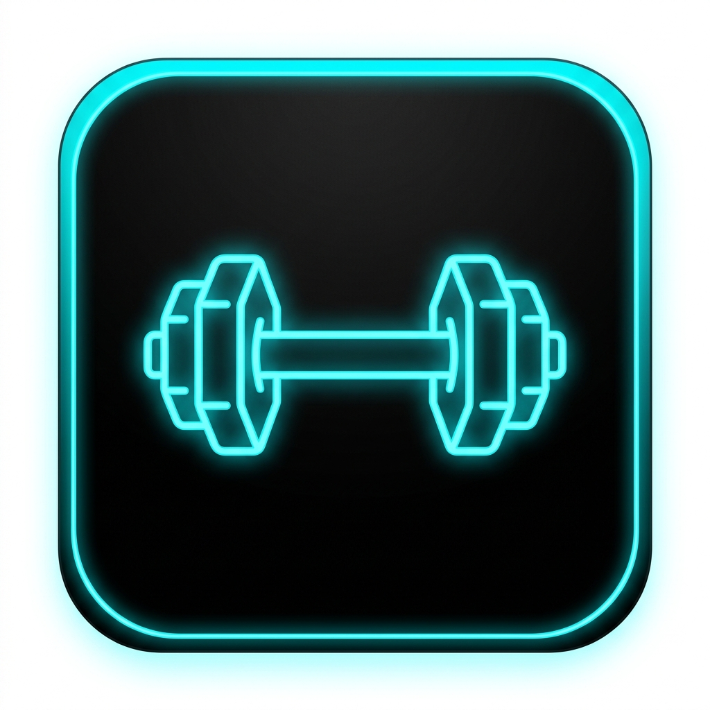
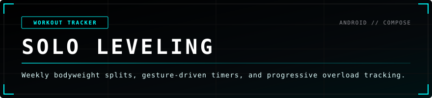

<div align="center">



<br /><br />



<br /><br />


</div>

<br />


## Overview

**Solo Leveling** is an Android workout tracker built with Jetpack Compose around a pitch-black OLED and neon cyan monospace interface. Training is organized into daily morning conditioning and split evening routines stored locally in Room with optional Firebase sync, allowing you to customize protocols, scale weekly progression modifiers, and resume paused workouts mid-session.


## Features

### Weekly Training Schedule
- **Morning Protocols:** Daily Warm-up & Cardio (mobility drills and timed intervals) paired with Morning Core.
- **Evening Split:**
  - **Monday / Thursday:** Evening Push (Chest, Shoulders, Triceps)
  - **Tuesday / Friday:** Evening Legs (Quads, Hamstrings, Calves)
  - **Wednesday / Saturday:** Evening Pull & Core
  - **Sunday:** Stretch & Walk active recovery
- **Today Highlighting:** Automatically detects the current day of the week and surfaces today's scheduled sessions on the dashboard.

### Interactive Workout Player
- **Gesture Controls:** Drag vertically anywhere on screen to adjust rep counts or add/subtract 5 seconds on timed holds; double-tap anywhere to complete the active set or skip an active rest timer.
- **Timed & Bilateral Holds:** Built-in countdown clock for duration-based exercises. Bilateral exercises (`each side`, such as Side Plank) run a 5-second side-switch countdown before auto-starting Side 2, alongside interactive `SIDE 1: LEFT` and `SIDE 2: RIGHT` toggles.
- **Rest Intervals & Cues:** Automated recovery countdowns with tone and haptic vibration feedback (`VIBRATE`), instant skip, and side-arrow step navigation.
- **Auto-Save & Resume:** Closing the player or pressing back automatically saves the active step index, completed sets, and current rep counts so you can continue right where you left off.

### Routine Editor & Progression
- **Routine Customization:** Edit any plan to add or remove exercises, switch targets between reps and timed seconds, update round counts in batch, or reset back to defaults.
- **Progressive Overload Engine:** Apply incremental modifiers for reps, sets, shorter rest intervals, harder variations, or cardio phase—or set exact weekly parameters manually.
- **History & Consistency Heatmap:** Inspect logged sessions alongside an activity heatmap tracking completed exercises, week numbers, and timestamps.

### Storage & Cloud Sync
- **Offline-First Persistence:** Local SQLite database powered by Room (`WorkoutDatabase`) for routines, progression state, user sessions, and workout logs.
- **Firebase Integration:** Optional authentication and Cloud Firestore sync via `FirebaseSyncManager`, with seamless fallback to local storage.


## Theme Palette

| Token | Hex | Role | Preview |
| :--- | :--- | :--- | :--- |
| `PitchBlack` | `#000000` | Primary background |  |
| `DarkGrey` | `#121212` | Elevated surfaces & cards |  |
| `NeonCyan` | `#00FFFF` | Primary accent & active borders |  |
| `MutedCyan` | `#008B8B` | Secondary accents |  |
| `TextGray` | `#8E8E93` | Muted labels & metadata |  |


## Tech Stack

| Layer | Technology |
| :--- | :--- |
| Language | Kotlin |
| UI Framework | Jetpack Compose, Material 3 |
| Concurrency | Kotlin Coroutines & StateFlow |
| Local Database | Room (with KSP) |
| Backend / Sync | Firebase Auth, Cloud Firestore |
| Build & Config | Gradle (Kotlin DSL), Version Catalog, Secrets Gradle Plugin |
| Testing | JUnit 4, Robolectric, Roborazzi |


## Project Structure

```text
app/src/main/java/com/example/
├── MainActivity.kt
├── data/
│   ├── local/
│   │   ├── WorkoutDao.kt
│   │   └── WorkoutDatabase.kt
│   ├── model/
│   │   ├── ProgressionStateEntity.kt
│   │   ├── UserEntity.kt
│   │   ├── WorkoutLogEntity.kt
│   │   ├── WorkoutPlanEntity.kt
│   │   └── WorkoutStep.kt
│   └── repository/
│       ├── FirebaseSyncManager.kt
│       └── WorkoutRepository.kt
└── ui/
    ├── WorkoutViewModel.kt
    ├── screens/
    │   ├── DashboardScreen.kt
    │   ├── EditWorkoutRoutineScreen.kt
    │   ├── ImmersiveWorkoutPlayer.kt
    │   └── LoginScreen.kt
    └── theme/
        ├── Color.kt
        ├── Theme.kt
        └── Type.kt
```


## Getting Started

### Prerequisites
- Android Studio (Ladybug or newer recommended)
- JDK 21 (or JDK 11+ source compatibility)
- Android SDK 36 (`minSdk 24`)

### Setup
1. Clone the repository:
   ```bash
   git clone https://github.com/<your-username>/solo-leveling-android.git
   cd solo-leveling-android
   ```
2. **(Optional)** Replace `app/google-services.json` with your own Firebase project configuration if you want to connect your own Auth and Firestore backend.
3. **(Optional)** Copy `.env.example` to `.env` if needed for local Secrets Gradle Plugin resolution.
4. Open the project in Android Studio and sync Gradle, or build and test from the command line:
   ```bash
   gradle assembleDebug
   gradle :app:testDebugUnitTest
   ```

### Automated Releases
Every push to `main` runs the GitHub Actions workflow in `.github/workflows/build-apk.yml`, compiling a signed debug APK and publishing it to the repository's **Releases** page for direct installation and testing.
